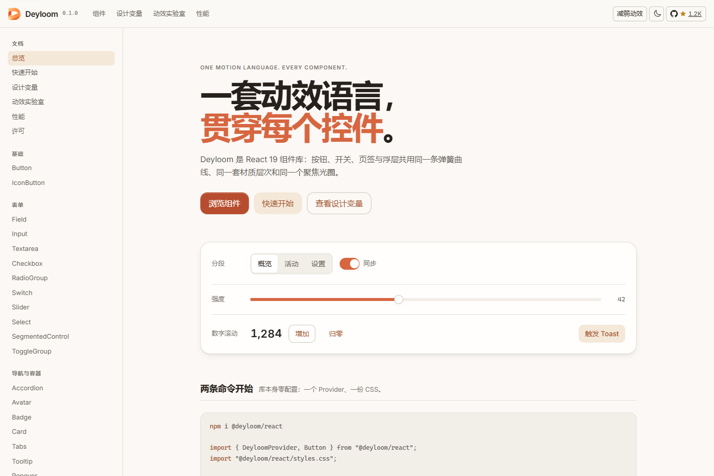
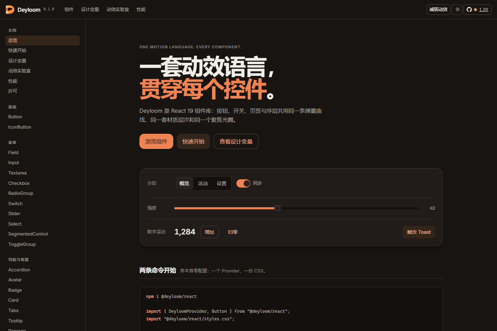
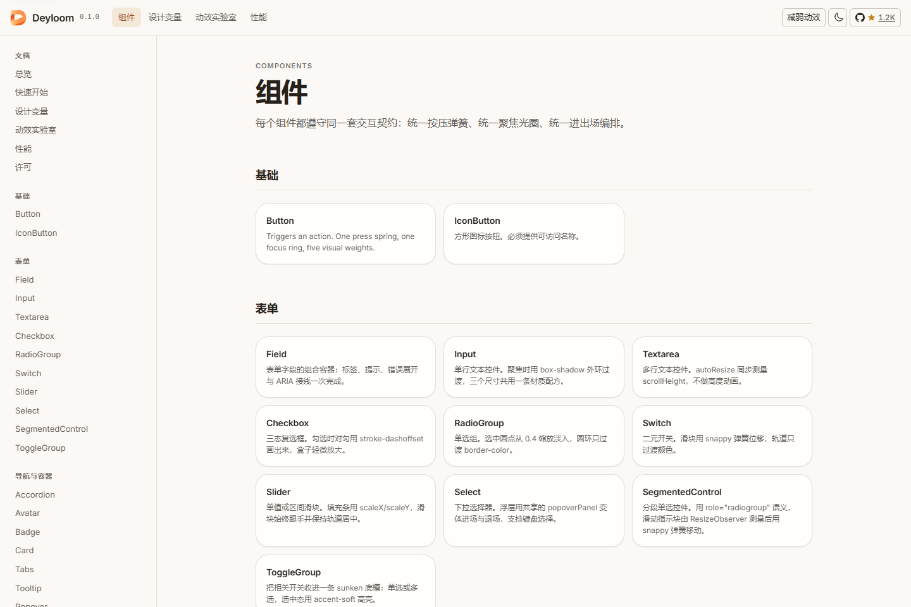
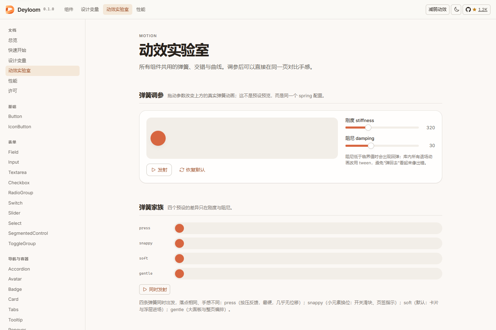
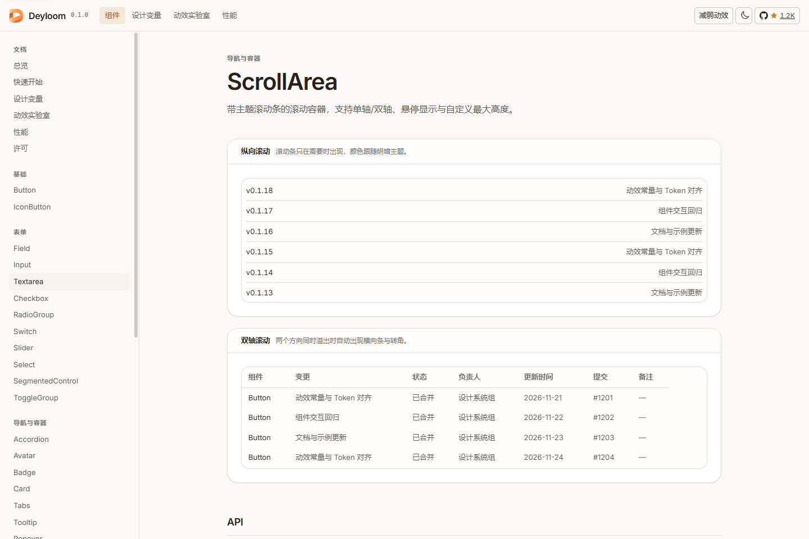
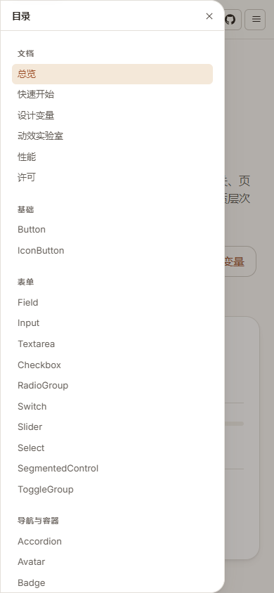

<p align="center">
  <picture>
    <source media="(prefers-color-scheme: dark)" srcset="brand/deyloom-logo.svg" />
    
  </picture>
</p>

<p align="center">One motion language. Every component.</p>

<p align="center">
  <a href="https://github.com/dm192/DeyloomUI">GitHub</a> ·
  <a href="apps/docs">文档源码</a> ·
  <a href="LICENSE">MIT</a>
</p>

## 快速开始

```bash
npm i @deyloom/react
```

```tsx
import { DeyloomProvider, Button } from "@deyloom/react";
import "@deyloom/react/styles.css";

export default function App() {
  return (
    <DeyloomProvider>
      <Button>保存</Button>
    </DeyloomProvider>
  );
}
```

本地查看文档站（含设计变量、动效实验室、性能与全部组件示例）：

```bash
npm install
npm run dev   # http://127.0.0.1:5173
```

## 预览

| 亮色 | 暗色 |
| --- | --- |
|  |  |

| 组件 | 动效实验室 |
| --- | --- |
|  |  |

| 滚动容器 | 移动端目录 |
| --- | --- |
|  |  |

## 许可

代码以 **MIT** 发布，个人与企业均可自由使用、修改与商用，保留版权声明即可。Deyloom 的名称、Logo、图标与字标**不在 MIT 范围内**：可用于 "Design by Deyloom"、技术栈声明等事实性署名，但不得作为自己的品牌、修改或重绘。详见 [LICENSE](LICENSE) 与 [TRADEMARK.md](TRADEMARK.md)。
